# Lab 2 — PID control of the pendulum

**Applied Optimal Control — laboratory handout 2 of 4 · groups of 2–3**

**Prerequisites:** Lab 1 rig card, working hardware, stored motor-alignment values, and the course software. Bring the rig card and your Lab 1 data. Keep the [library reference](../FOC_libraries_student_reference.md) open while you program.

## Learning goals

By the end of this lab you should be able to:

- design the gains of a PID controller for the pendulum from its model (pole placement of the linearized system), for the stable hanging equilibrium and for the unstable upright one;
- implement a discrete PID controller with derivative-on-measurement and balance the pendulum when it starts a little away from the equilibrium (**Part 1**);
- explain why a linear controller with a torque limit cannot lift the pendulum from the bottom, and implement an energy-based swing-up that brings it to the top, where your PID takes over (**Part 2**).

## Safety and stop procedure

The pendulum may swing and spin quickly, and the motor remains energized during a run. Clear the area and keep hair and cables away from the arm. Know the stop command: send `x` in the Serial Monitor to command 0 V. Begin with the Lab 1 voltage limit; do not raise it above the instructor-approved value. For the very first run use `MOTOR_VOLTAGE_LIMIT = 1.0` V and check the sign of the response (Part 1, test A) before anything else.

In Part 1 you lift the pendulum to the top **by hand**. The motor is weak (a few tens of mN·m on maximum operation), so this is safe, but move slowly, hold the arm near the hub, and let go gently once the controller has taken over.

## 1. Model and controller

### 1.1 Model

Use $\theta=0$ for hanging and $\theta=\pi$ for upright. Near the top, let $\varphi=\theta-\pi$. From Lab 1,

$$
\boxed{\;J\ddot{\theta}=\tau-b\dot{\theta}-\tau_c\,\mathrm{sign}(\dot\theta)-G\sin\theta\;},
\qquad
J=\left(\frac{m_r}{3}+m_p\right)l^2,
\qquad
G=\left(\frac{m_r}{2}+m_p\right)lg,
$$

where

$$
\boxed{\tau=k\left(U-K_e\dot\theta\right)=k\left(U-K_e\omega\right)}.
$$

Your controller sends a desired **torque** command $\tau_{des}$. The back-EMF and the Coulomb friction are compensated outside your controller: with `USE_BACK_EMF_COMP 1` the motor delivers the requested torque as the speed changes, so the model uses the mechanical friction $b$ (not $b+kK_e$), and with `USE_COULOMB_COMP 1` the library adds the feed-forward $\tau_c\,\mathrm{sign}(\omega)$. The voltage applied is

$$
\boxed{U=\frac{\tau_{des}+\tau_c\,\mathrm{sign}(\omega)}{k}+K_e\omega}.
$$

The Coulomb friction has no linearization, so the linear design below contains $b$ only. Without the feed-forward it leaves a small dead band around the target equilibrium, and the integral term slowly removes the remaining offset.

So, after the substitution, we get our known dynamics for the single pendulum (from now on we are going to call and symbolize $\tau_{des}$ as $\tau$). They can be further linearized handling the $\sin\theta$ term as shown in [Appendix A](#appendix-a--why-the-pd-formulas-work-laplace-and-state-space-derivations).

$$
\boxed{\;J\ddot{\theta}+b\dot{\theta}+G\sin\theta=\tau_{des}=\tau\;}.
$$

### 1.2 The PID law

With the error $e=r-\theta$ (reference $r=0$ hanging, $r=\pi$ upright, wrapped to $[-\pi,\pi)$) and the measured velocity $\omega$:

$$
\boxed{\tau=k_p e+k_i\int e\,dt-k_d\omega}.
$$

The derivative acts on the **measurement** ($-k_d\omega$ instead of $k_d\dot e$): a reference step would make $\dot e$ a spike (the "derivative kick"), while $\omega$ is smooth. The controller runs every $T_s=10$ ms; integrate with the measured period, $\int e\,dt \approx \sum e\,\Delta t$.

### 1.3 Gains from the model (pole placement)

Linearize around the equilibrium. With $x$ the deviation from it, $J\ddot x+b\dot x+qx=\tau$ with $q=+G$ (hanging: gravity pulls back) or $q=-G$ (upright: gravity pushes away). The PD loop has the characteristic polynomial $Js^2+(b+k_d)s+(q+k_p)$; matching it to $J(s^2+2\zeta\omega_n s+\omega_n^2)$ gives the **torque gains**:

**Hanging position:**

$$
\boxed{k_p=J\omega_n^2-G,\qquad k_d=2\zeta\omega_nJ-b}\qquad(\text{needs } \omega_n^2>G/J).
$$

**Upright position:**

$$
\boxed{k_p=J\omega_n^2+G,\qquad k_d=2\zeta\omega_nJ-b}.
$$

The sign of $G$ is the whole difference between the two problems: at the top the controller must first overcome gravity ($k_p>G$) before it can do anything else. Start with $\omega_n=25$ rad/s (hanging), $\omega_n=15$ rad/s (upright) and $\zeta=0.7$. The integral gain is set as a fraction $\ell$ of $k_p$: $k_i= \ell \cdot\,k_p$ (for example $\ell = 1 s^{-1}$ hanging, $\ell = 0.5 s^{-1}$ upright; $\ell = 0$ gives a PD). It adds a third, slow pole; the full derivation, the third-order polynomial and the Routh bound on $k_i$ are in [Appendix A](#appendix-a--why-the-pd-formulas-work-laplace-and-state-space-derivations).

### 1.4 The torque limit

The motor can apply at most $\tau_{\max}=kU_{\max}$. If $\tau_{\max}<G$, gravity wins beyond the angle where $G\sin\varphi=\tau_{\max}$: starting at rest, the largest recoverable angle from the top is

$$
\boxed{\varphi_c=\arcsin\left(\frac{\tau_{\max}}{G}\right)}.
$$

Inside it the PID behaves as designed; near its edge the output saturates and the pendulum hovers before it comes back; beyond it the pendulum falls, whatever the gains. In Part 1 you do not have to design for this limit (the sketch and `FOC_lar` clamp the command for you), but you must start close enough to the top. In Part 2 the limit is the reason for the swing-up.

## 2. Model calculations (do these at the start, with your rig card)

Use your Lab 1 rig card.

1. Calculate $J$, $G$, $\omega_0=\sqrt{G/J}$, and $\tau_{\max}=kU_{\max}$.
2. Calculate the hanging and the upright $k_p$, $k_d$ and $k_i$ with the settings of 1.3.
3. Calculate $\tau_{\max}/G$ and, if $\tau_{\max}<G$, $\varphi_c$. How close to the top must you bring the pendulum in Part 1?
4. (Part 2) Compute $\omega_{top}=\sqrt{4G(\rho-1)/J}$ for $\rho=1.03$ and confirm it is below the capture speed of 8 rad/s.

## 3. The sketch

Open `sketches/pendulum_pid_student/pendulum_pid_student.ino`. It is short and has two kinds of code:

- **Given:** the rig settings (`#define`s), the motor and pendulum objects, the print helpers and the serial keys (`handleCommands()`). In the `#define`s enter your rig card values (`TORQUE_CONSTANT`, `MOTOR_KE`, masses, length, `VISCOUS_FRICTION`, `COULOMB_FRICTION`) and the two `STORED_...` alignment lines.
- **Yours** (marked `TODO`, with step-by-step instructions in the comments):
  - `setup()`: start the motor with the stored alignment and the Lab 1 calibration, start the pendulum, give it its model, the Coulomb compensation and the capture angles, and compute the gains. The print calls at the end are given.
  - `loop()`: run the FOC algorithm, let `pendulum.update()` read the keys and the sensor, reset the controller when a run starts, and once per control period compute, apply and log the torque. The call of `handleCommands()` is given.
  - the section `YOUR CONTROLLER`: four functions, whose names are fixed and whose bodies are empty:

| Function | Called | What it must do |
|---|---|---|
| `void designController()` | at power-up (from your `setup()`) and on `1` / `2` | compute $k_p$, $k_i$, $k_d$ for the selected `equilibrium` (1 hanging, 2 upright); print them with `printGains(kp, ki, kd)` |
| `void clearControllerState()` | at every start (from your `loop()`) and on `1`, `2`, `u` | clear the memory of the controller (the integral, the swing-up direction) |
| `float controlTorque()` | once per control period (from your `loop()`) | return the torque (N·m) to apply now |
| `float swingUpTorque(theta, omega)` | from your `controlTorque()` (Part 2) | return the energy swing-up torque (N·m) of 5.2 |

- **Yours, in the library too.** Some functions of `Pendulum_lar` are TODOs, with step-by-step instructions in the code. Edit them in the copy in your Arduino libraries folder (`libraries/Pendulum_lar/`), which the IDE recompiles with your sketch:

| File | Function | What it must do | When |
|---|---|---|---|
| `Pendulum_lar.cpp` | `update()` | the actual control period `dt`, the angle `theta` from the sensor position, and the filtered velocity `omega` | Part 1 |
| `Pendulum_lar.cpp` | `applyTorque()` | the Coulomb feed-forward $\tau_c\,\mathrm{sign}(\omega)$ and the torque command (with `FOC_lar::setTargetTorque()`) | Part 1 |
| `PendulumModel.cpp` | `setParameters()` | $J$, $G$, $b$, $\tau_c$ of 1.1 from the masses and the length | Part 1 |
| `Pendulum_lar.cpp` | `updateMode()` | the swing-up ↔ balance switching with hysteresis (5.3) | Part 2 |
| `PendulumModel.cpp` | `energy()` | $E=\tfrac12J\omega^2+G(1-\cos\theta)$ (5.2) | Part 2 |
| `PendulumModel.cpp` | `acceleration()`, `step()`, `linearize...()`, `discretize...()` | the nonlinear model and its linearizations | Lab 3: leave them |

  Until you complete a TODO it returns a harmless placeholder: before your Part 1 library code the motor stays at 0 V and $\theta=\omega=0$; before your Part 2 code `updateMode()` always returns `BALANCE`.

Two objects do the work for you (details in the [library reference](../FOC_libraries_student_reference.md)):

- `foc` (`FOC_lar`): the motor, as in Lab 1. You do not call it in the controller.
- `pendulum` (`Pendulum_lar`): the measured state `pendulum.theta` (rad, continuous, 0 = hanging at the start), `pendulum.omega` (rad/s) and `pendulum.dt` (s); the model `pendulum.inertia()`, `gravityTorque()`, `viscousFriction()`, `energy(theta, omega)`, `energyUpright()`, `maxTorque()`; and the switch `pendulum.updateMode()` (your Part 2 TODO), which returns `Pendulum_lar::BALANCE` while the pendulum is within `CAPTURE_ANGLE` of the top (and slower than 8 rad/s) and `Pendulum_lar::SWING_UP` once it is farther than `RELEASE_ANGLE`. Helpers: `pendulum_wrap_angle()`, `pendulum_clamp()`, `pendulum_sign()`, `PENDULUM_LAR_PI`.

The torque you return is applied with the back-EMF compensation and the Coulomb feed-forward, and logged.

**Serial commands.** `s` starts a run (the pendulum must hang at rest: that is $\theta=0$) and `x` stops it (0 V). `1` / `2` select the hanging / upright equilibrium (`EQUILIBRIUM` only sets the value at power-up). `u` switches the swing-up helper on and off (`USE_SWING_UP` sets it at power-up). `p` pauses the CSV log, `h` prints the list.

**Logging (optional).** Close the Serial Monitor and capture a run with `python tools/plot_log.py --port /dev/ttyUSB0 --out run.csv` (on Windows use your port, e.g. `COM3`); the script sends `s`, saves the CSV and plots it. The `mode` column is 1 while the PID balances at the top.

## 4. Part 1 — a PID that holds the equilibrium

Leave `USE_SWING_UP 0`.

0. **The library, Part 1 TODOs** (`update()`, `applyTorque()`, `setParameters()`, see section 3). Without them the sketch runs but measures nothing and commands 0 V.
1. **`setup()` and `loop()`.** Follow the numbered steps in their comments. The calls are the ones of the [library reference](../FOC_libraries_student_reference.md) (section 1.2 shows the same structure); `foc.begin()` with the stored alignment is the one of Lab 1. Compile before going on.
2. **The PID.** Keep $k_p$, $k_i$, $k_d$ and the integral of the error together, for example in a small `struct` with a `reset()` and an `update(error, omega, dt)` that returns the torque of 1.2. Wrap the error with `pendulum_wrap_angle()`, otherwise a full turn looks like an error of $2\pi$.
3. **`designController()`:** the formulas of 1.3 with `pendulum.inertia()`, `pendulum.gravityTorque()`, `pendulum.viscousFriction()` and the `PID_...` defines. Do not allow negative gains. The sketch prints the gains at power-up: compare them with your Section 2 numbers.
4. **`clearControllerState()`:** set the integral to zero.
5. **`controlTorque()`:**
   - hanging (`equilibrium == 1`): the PID with reference 0, always;
   - upright (`equilibrium == 2`): call `pendulum.updateMode()`. While it returns `Pendulum_lar::BALANCE`, use the PID with reference `PENDULUM_LAR_PI`; otherwise return 0 for now. Reset the integral at the moment the mode becomes `BALANCE` (read `pendulum.mode()` before calling `updateMode()` to detect the change). In Part 1 `updateMode()` is still the library placeholder that always returns `BALANCE`, so the PID is always in control; the other branch starts to work in Part 2.

You do not have to handle the torque limit in Part 1.

### Test A — hanging: sign check and a push

Select `1` (hanging). First run with `MOTOR_VOLTAGE_LIMIT 1.0`: send `s`, move the arm a little by hand and check that the motor pushes it **back** to $\theta=0$. If it pushes away, stop and check the sensor direction and the sign of your error. Then restore your voltage limit.

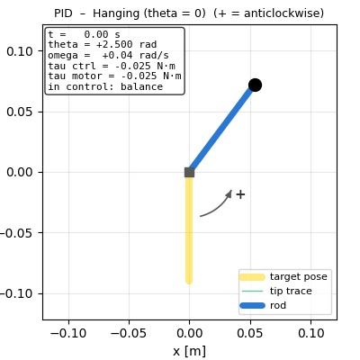 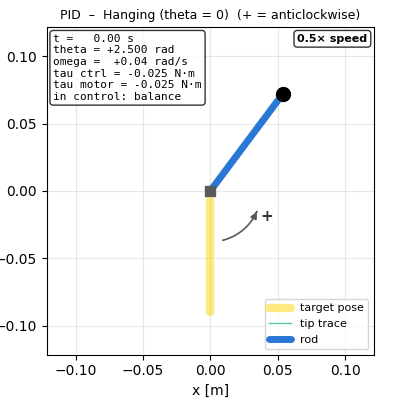\
**The hanging PID brings the pendulum back after it is released 2.5 rad from the bottom (simulation) (left: real time; right: 0.5× slow motion).**

Set `RUN_TIME_S` to about 60 s, start a run, give the mass one firm push and let it settle.

***Optional:** Save the log as `hang_pid.csv`.*

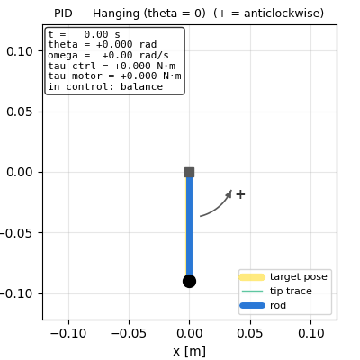 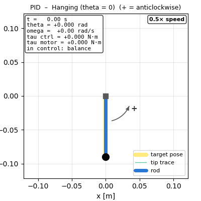\
**A strong push (−6 rad/s at 0.5 s) at the hanging equilibrium; the PID brings the pendulum back in about 0.2 s (simulation) (left: real time; right: 0.5× slow motion).**

***Optional:** Record the peak angle after the push, the recovery time, the number of oscillations, the final resting angle and the peak voltage. Repeat once with `PID_KI_OVER_KP_HANGING 0` (PD), save `hang_pd.csv`. With the Coulomb feed-forward on the difference may be small; with `USE_COULOMB_COMP 0` it is clearer.*

### Test B — upright: lift it by hand

Select `2` (upright, the sketch prints *PID only: lift the pendulum by hand*). Start a run with the pendulum hanging. The PID is in control from the start, but from the bottom it cannot lift the pendulum: the torque saturates and the pendulum only tilts to one side (5.1 explains why). Lift it slowly by hand towards the top, in the direction the motor pushes; near the top you feel the motor pull it up. Bring it closer than $\varphi_c$ and let go gently. 

***Optional:** Save the log as `upright_pid.csv`.*

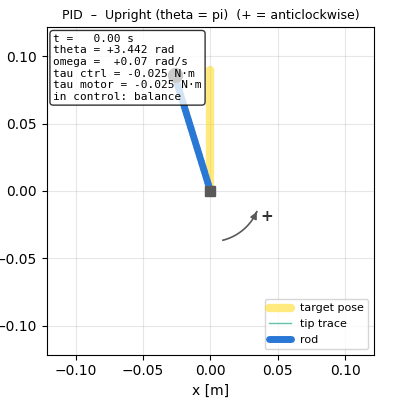 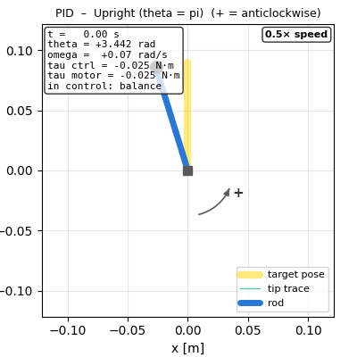\
**What you should see: released at rest 0.3 rad from the top, the PID brings the pendulum upright and holds it (simulation) (left: real time; right: 0.5× slow motion).**

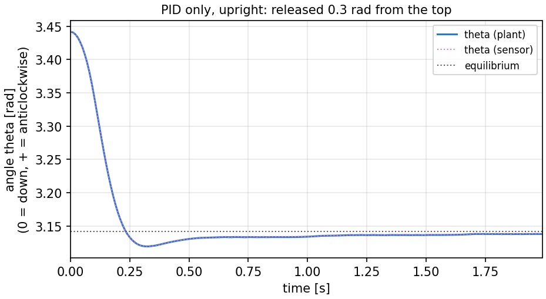\
**The same run: θ(t) settles at π within about 0.2 s; the small slow tail is the integral term removing the last offset.**

***Optional:** Record the capture (does the motor take over smoothly?) and whether it stays upright for the rest of the run, the RMS of $\varphi$ during the last 10 s and the peak $|U|$, and the peak $|\varphi|$ and recovery time after a gentle tap on the balanced mass.*

If the pendulum is caught and then falls, check if the torque is saturated. If your $\tau_{\max}/G$ is small, $\varphi_c$ is small too, and you must bring the pendulum within a few degrees of the top before letting go.

## 5. Part 2 — the swing-up helper

### 5.1 Why a helper is needed

A PID is a linear spring and damper around one point: from the bottom its error is $\pi$, it saturates, and with $\tau_{\max}<G$ it can only tilt the pendulum to the angle where $G\sin\theta=\tau_{\max}$. It does not pump energy into the swing. (With $\tau_{\max}$ close to $G$ the overshoot of the saturated PID can happen to carry the pendulum over the top; that is luck, not design.)

 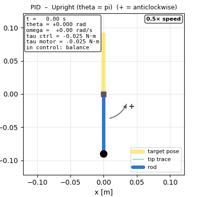\
**PID alone, started at the bottom with $τ_{max} = 0.46\; G$: the torque saturates, the pendulum swings once and settles tilted at $arcsin(τ_{max}/G)\approx 0.48\; rad$; it never reaches the top (simulation) (left: real time; right: 0.5× slow motion).**

### 5.2 Energy-based swing-up

Instead of the angle, control the **energy** $E=\tfrac12J\omega^2+G(1-\cos\theta)$, which is 0 at rest at the bottom and $E_{up}=2G$ at rest at the top, when the system is at rest ($\omega=0$). Without friction, $\dot E=\tau\,\omega$: torque in the direction of motion adds energy. The swing-up pushes with the full torque along the velocity while $E$ is below a target slightly above the top, and tapers as it gets close:

$$
\boxed{\tau_{swing}=\operatorname{sat}\!\Big(\frac{\rho E_{up}-E}{B\,E_{up}}\Big)\,\tau_{\max}\,\operatorname{sign}(\omega)=\operatorname{sat}\!\Big(\frac{\rho-E/E_{up}}{B}\Big)\,\tau_{\max}\,\operatorname{sign}(\omega)}
$$

Defining the dimensionless control coefficient as

$$
\alpha=\operatorname{sat}\!\Big(\frac{\rho-E/E_{up}}{B}\Big),
$$

the torque equation becomes $\tau_{swing}=\alpha\tau_{\max}\operatorname{sign}(\omega)$. The coefficient $\alpha$ determines the magnitude and energy-increasing or energy-decreasing behaviour of the applied torque. When the current energy $E$ is below the target energy $\rho E_{up}$, $\alpha$ is positive, so the motor applies torque in the direction of motion, adding energy to the pendulum. As the energy approaches the target, $\alpha$ gradually decreases towards zero, reducing the applied torque. At $E=\rho E_{up}$, $\alpha=0$, meaning that no swing-up torque is commanded. If the energy exceeds the target, $\alpha$ becomes negative, causing the motor torque to act against the direction of motion and remove excess energy. The saturation function restricts $\alpha$ to the range $[-1,1]$, ensuring that the commanded torque does not exceed the maximum motor torque $\tau_{\max}$.

With $B=0.10$ (`SWING_ENERGY_BAND`), $\rho=1.03$ (`SWING_ENERGY_RATIO`) and $\operatorname{sat}(x)=\max(-1,\min(1,x))$, the controller applies full energy-increasing torque when $E\leq0.93E_{up}$, gradually reduces the torque until it reaches zero at $E=1.03E_{up}$, and increases the energy-removing torque until it reaches its maximum magnitude at $E=1.13E_{up}$.

At rest, $\operatorname{sign}(0)=0$ would never start the swing, so keep the last push direction while $|\omega|<0.3$ rad/s (`SWING_KICK_SPEED`; start with $+1$). With $E=\rho E_{up}$, the pendulum crosses the top at

$$
\omega_{top}=\sqrt{\frac{4G(\rho-1)}{J}},
$$

well below the 8 rad/s capture speed of `updateMode()`, so it can be caught instead of spinning over.

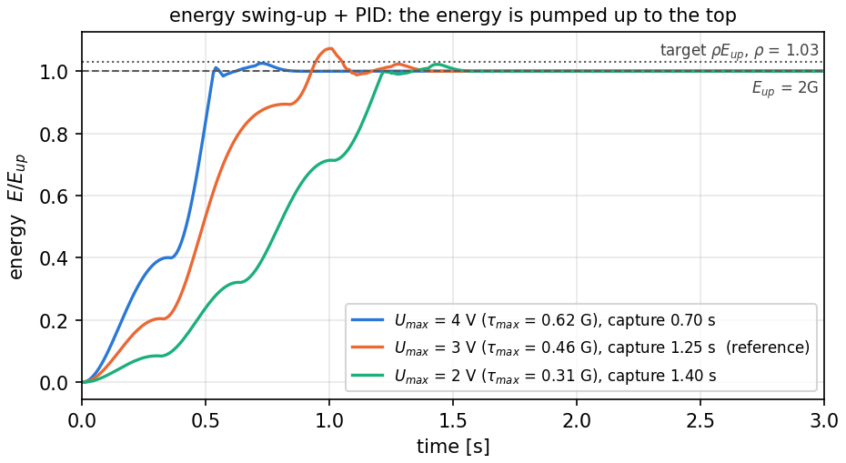\
**Energy during the swing-up for three voltage limits (3 V by default): each swing adds energy until E reaches the energy of the top; with less torque it takes more swings and longer (simulation).**

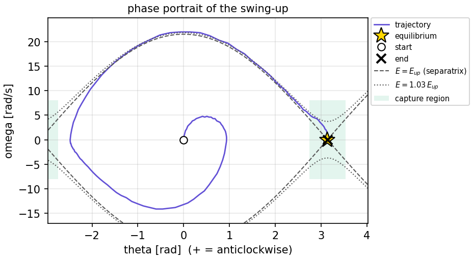\
**Phase portrait of the swing-up (3 V by default): the trajectory spirals out, one swing at a time, until it follows the energy level of the top (the separatrix, dashed) into the capture region (shaded), where the PID takes over (simulation; the same plot is in the Phase portrait tab of the GUI).**

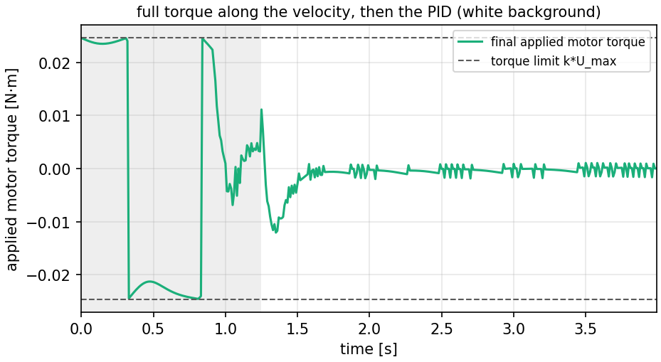\
**Torque of the same run: ±τmax along the velocity while the energy is low (gray background: swing-up in control), tapering near the target, then the small balancing torque of the PID (simulation).**

### 5.3 Implement

0. Complete the Part 2 TODOs of the library: `updateMode()` in `Pendulum_lar.cpp` (step-by-step instructions in the code: the distance from the top wrapped with `pendulum_wrap_angle()`, the capture condition, the release condition, the hysteresis between the two) and `energy()` in `PendulumModel.cpp`. From now on, in the upright equilibrium the PID is only in control near the top, and the motor lets go when the pendulum falls (`u` off) or the swing-up takes over (`u` on).
1. Complete `swingUpTorque(theta, omega)`, which returns $\tau_{swing}$: `pendulum.energy(theta, omega)`, `pendulum.energyUpright()`, `pendulum.maxTorque()`, `pendulum_sign()`, `pendulum_clamp()`, and a global variable for the push direction (reset it to $+1$ in `clearControllerState()`).
2. In `controlTorque()`, return it instead of 0 when `use_swing_up` is true and the mode is `SWING_UP`.
3. Make the PID **saturation-aware**, because the capture now happens at speed and the torque saturates: clamp its output to $\pm$`pendulum.maxTorque()` and update the integral only while the output is not saturated (**anti-windup**), keeping $|\int e\,dt|\le 0.5\,\tau_{\max}/k_i$. Otherwise the integral grows during saturation and the controller overshoots long after.

### 5.4 Run

Set `USE_SWING_UP 1` (or press `u`), select `2`, and start with the pendulum hanging at rest. Run for about 20 s and save `swingup_pid.csv`.

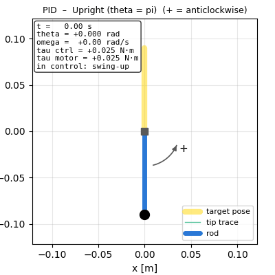 \
**Energy swing-up + PID: two pumping swings, capture near the top after about 1.25 s, balance (simulation, 3 V voltage limit) (left: real time; right: 0.5× slow motion).**

Record:

- whether the pendulum was captured, the capture time and the number of swings;
- whether it stayed upright, the RMS of $\varphi$ during the last 10 s and the peak $|U|$;
- any fall, prolonged saturation, hunting or visible oscillation.

If it does not capture, check the energy in the log and your rig parameters ($G$, $J$); if it captures and then falls, look at the speed and the saturation at the capture. Stop the run if it behaves unexpectedly; do not increase the voltage limit without approval.

## 6. One extra test (if time allows)

Choose **one**:

- change `PID_WN_UPRIGHT` from 15 to 10 or 25 rad/s and compare capture and balance quality;
- tap the balanced pendulum harder and harder: what is the largest push it recovers from, and does the swing-up bring it back after a fall?
- set `USE_COULOMB_COMP 0` and repeat the upright balance: compare the hunting amplitude at the top with the compensated run.

Save the log and state what changed compared with the baseline.

---

## Appendix A — Why the PD formulas work: Laplace and state-space derivations

The formulas of section 1.3 come from linearizing the pendulum around the selected equilibrium and matching the closed-loop characteristic polynomial to a desired second-order polynomial. This is a continuous-time design calculation; the discrete controller, torque/voltage limits, friction, and swing supervisor can change the measured response.

### A.1. Local coordinates and the linearized plant

Use $x$ for the small deviation from the equilibrium:

$$
x=\begin{cases}
\theta, & \text{hanging equilibrium},\\
\varphi=\theta-\pi, & \text{upright equilibrium}.
\end{cases}
$$

For regulation, the reference deviation is zero in both cases, so $r_x=0$ and the error is $e=r_x-x=-x$. Around the hanging point, $\sin\theta\approx\theta=x$. Around the upright point, $\sin(\pi+\varphi)\approx-\varphi=-x$. Since Coulomb friction is compensated by the feed-forward term for the nominal design, its nonsmooth sign function is not included in the linear model. The resulting local model is

$$
J\ddot{x}+b\dot{x}+q x=\tau,
\qquad
q=\begin{cases}
+G, & \text{hanging},\\
-G, & \text{upright}.
\end{cases}
$$

Thus gravity is restoring near hanging ($q=+G$) and destabilizing near upright ($q=-G$). The gains $k_p$ and $k_d$ are torque gains: they map angle error and angular rate to torque, not directly to voltage.

### A.2. Laplace derivation for PD pole placement

First set $k_i=0$. With zero initial conditions, the plant equation becomes

$$
(Js^2+bs+q)X(s)=T(s).
$$

For the regulation problem, $r_x=0$, so $e=-x$ and the PD law gives

$$
T(s)=-(k_p+k_d s)X(s).
$$

Substitute the controller into the plant equation and collect the terms multiplying $X(s)$:

$$
\bigl[Js^2+(b+k_d)s+(q+k_p)\bigr]X(s)=0.
$$

The closed-loop characteristic polynomial is therefore

$$
A_{PD}(s)=Js^2+(b+k_d)s+(q+k_p).
$$

The poles are the roots of $A_{PD}(s)=0$. They do not depend on having a nonzero reference: the reference determines the forced response, whereas the characteristic polynomial determines the free dynamics. With zero reference and zero initial conditions the response is trivially zero; an initial displacement or velocity produces a free response whose modes are governed by these same poles.

Choose the desired second-order polynomial

$$
s^2+2\zeta\omega_n s+\omega_n^2,
$$

and multiply it by $J$ to match the leading coefficient of $A_{PD}(s)$:

$$
A_{des}(s)=Js^2+2\zeta\omega_n J s+J\omega_n^2.
$$

Matching the coefficients of $s$ and the constant term gives

$$
b+k_d=2\zeta\omega_n J,
\qquad q+k_p=J\omega_n^2.
$$

Hence

$$
\boxed{k_d=2\zeta\omega_n J-b},
\qquad
\boxed{k_p=J\omega_n^2-q}.
$$

Inserting the two values of $q$ gives exactly the two formulas used in this handout:

$$
\boxed{k_{p,\mathrm{hanging}}=J\omega_n^2-G},
\qquad
\boxed{k_{p,\mathrm{upright}}=J\omega_n^2+G}.
$$

The derivative gain is the same expression for both equilibria:

$$
\boxed{k_d=2\zeta\omega_nJ-b}.
$$

For hanging, $k_p>0$ requires $\omega_n^2>G/J$, which is the condition stated above. If the software clips a negative gain to zero, the clipped gains no longer place the poles exactly at the requested locations. Likewise, clipping $k_d$ changes the achieved damping.

The same PD result can be written as a reference-to-angle transfer function. For a reference deviation $r_x$ and derivative-on-measurement, the derivative term acts on $x$, not on $r_x$. With $k_i=0$ this yields

$$
\frac{X(s)}{R_x(s)}=\frac{k_p}{Js^2+(b+k_d)s+(q+k_p)}.
$$

For the laboratory's regulation runs, $R_x(s)=0$; the transfer function is still useful for understanding how the reference would affect the system, and its denominator remains the characteristic polynomial.

### A.3. What changes when $k_i$ is nonzero?

The controller used in the sketch is

$$
\tau=k_p e+k_i\int e\,dt-k_d\omega,
$$

where $\omega=\dot{x}$ is the measured angular velocity and the derivative is on the measurement. With zero reference, $e=-x$, so

$$
\tau=-k_p x-k_i\int x\,dt-k_d\dot{x}.
$$

Define $w(t)=\int_0^t x(\lambda)\,d\lambda$, so $\dot{w}=x$. The controller is then $\tau=-k_p x-k_d\dot{x}-k_i w$. The augmented characteristic polynomial is

$$
\boxed{A_{PID}(s)=Js^3+(b+k_d)s^2+(q+k_p)s+k_i}.
$$

The full PID system is third order. Therefore, the $\zeta$ and $\omega_n$ formulas above place the desired second-order poles for the PD design ($k_i=0$); by themselves they do not determine all three poles when $k_i\ne0$. The sketch sets $k_i$ using `PID_KI_OVER_KP_HANGING` or `PID_KI_OVER_KP_UPRIGHT`, which is an additional tuning rule rather than a consequence of the second-order coefficient matching. Begin with the recommended ratio, then check the measured response and saturation. Integral action, torque clamping, and anti-windup all influence the response away from the ideal PD prediction.

For completeness, with a nonzero reference deviation $r_x$ and the sketch's derivative-on-measurement convention, the same equations give

$$
\boxed{\frac{X(s)}{R_x(s)}=\frac{k_p s+k_i}{Js^3+(b+k_d)s^2+(q+k_p)s+k_i}}.
$$

Equivalently,

$$
\bigl[Js^3+(b+k_d)s^2+(q+k_p)s+k_i\bigr]X(s)=(k_p s+k_i)R_x(s).
$$

For regulation runs $R_x(s)=0$. This does not remove the closed-loop poles; it means the reference contributes no forced response, while initial conditions can still produce a transient.

If exact third-order pole placement is needed, choose an additional real pole at $-p_3$ with $p_3>0$ and prescribe

$$
A_{des,3}(s)=J(s+p_3)(s^2+2\zeta\omega_n s+\omega_n^2).
$$

Expanding and matching coefficients to $A_{PID}(s)$ gives

$$
\boxed{k_d=J(2\zeta\omega_n+p_3)-b},
$$

$$
\boxed{k_p=J(\omega_n^2+2\zeta\omega_n p_3)-q},
$$

$$
\boxed{k_i=Jp_3\omega_n^2}.
$$

This is an optional design extension, not the gain rule used by the supplied sketch; the extra pole $p_3$ must be chosen and the resulting gains checked against actuator limits.

### A.4. Equivalent state-space derivation

Define the plant state

$$
\mathbf{x}=\begin{bmatrix}x\\\dot{x}\end{bmatrix}.
$$

The linearized plant can be written as

$$
\dot{\mathbf{x}}=
\underbrace{\begin{bmatrix}0&1\\-q/J&-b/J\end{bmatrix}}_{A_p}
\mathbf{x}
+
\underbrace{\begin{bmatrix}0\\1/J\end{bmatrix}}_{B_p}\tau.
$$

For PD regulation, $\tau=-k_p x-k_d\dot{x}$. Therefore,

$$
\dot{\mathbf{x}}=A_{cl,PD}\mathbf{x},
$$

where

$$
A_{cl,PD}=A_p-B_p\begin{bmatrix}k_p&k_d\end{bmatrix}
=
\begin{bmatrix}
0&1\\
-(q+k_p)/J&-(b+k_d)/J
\end{bmatrix}.
$$

In state space, the closed-loop poles are the eigenvalues of $A_{cl,PD}$. They satisfy

$$
\det(sI-A_{cl,PD})=0.
$$

Evaluating the determinant gives

$$
s^2+\frac{b+k_d}{J}s+\frac{q+k_p}{J}=0,
$$

which, after multiplying by $J$, is exactly the same characteristic polynomial as the Laplace derivation:

$$
Js^2+(b+k_d)s+(q+k_p)=0.
$$

For PID, augment the state with $w=\int x\,dt$. Then

$$
\begin{bmatrix}
\dot{x}\\
\ddot{x}\\
\dot{w}
\end{bmatrix}
=
\underbrace{\begin{bmatrix}
0&1&0\\
-(q+k_p)/J&-(b+k_d)/J&-k_i/J\\
1&0&0
\end{bmatrix}}_{A_{cl,PID}}
\begin{bmatrix}
x\\
\dot{x}\\
w
\end{bmatrix}.
$$

The PID poles are the eigenvalues of $A_{cl,PID}$, found from $\det(sI-A_{cl,PID})=0$. The result is

$$
Js^3+(b+k_d)s^2+(q+k_p)s+k_i=0,
$$

identical to the Laplace-domain result. In short: **Laplace analysis finds the roots of the characteristic polynomial; state-space analysis finds the eigenvalues of the closed-loop matrix. They describe the same poles.**

### A.5. Damping, overshoot, and the practical actuator

For an ideal underdamped second-order step response ($0<\zeta<1$), the overshoot fraction is

$$
M_p=\exp\left(-\frac{\pi\zeta}{\sqrt{1-\zeta^2}}\right).
$$

A value $\zeta=1$ is critically damped in the ideal second-order model and has no oscillatory step-response overshoot. This lab's prescribed initial value $\zeta=0.7$ is a practical starting point, not a no-overshoot guarantee. The response can differ because of integral action, nonlinear gravity, torque/voltage saturation, delays, discretization, or imperfect friction compensation.

The motor-voltage relation in this handout,

$$
U=\frac{\tau+\tau_c\,\mathrm{sign}(\omega)}{k}+K_e\omega,
$$

is intended to make the motor deliver the requested controller torque while compensating for Coulomb friction and back-EMF. The nominal pole derivation therefore uses the mechanical damping $b$, as stated above, rather than adding $kK_e$ to it. In the implementation, voltage saturation and delayed commands can prevent the motor from delivering the requested torque; the actual closed-loop response should always be checked in the log. The motor torque is not the same as the net mechanical torque, because gravity and mechanical friction still act on the pendulum.
