# Lab 3 — LQR control of the pendulum

**Applied Optimal Control — laboratory handout 3 of 4 · groups of 2–3**

**Prerequisites:** Lab 1 rig card and motor calibration; Lab 2 completed, including the `Pendulum_lar` measurement, torque-command and mode-switching TODOs. Bring your rig card and your Lab 2 library. The theory follows *Lecture 4: Deterministic Optimal Control & LQR* and uses its notation.

## Learning goals

By the end of this lab you should be able to:

- linearize the pendulum about the hanging and the upright equilibria and discretize the linear model with a zero-order hold;
- compute the infinite-horizon discrete-time LQR gain by iterating the Riccati recursion until it converges (the discrete algebraic Riccati equation, DARE);
- check the stability of the closed loop from the eigenvalues of $A-BK$, and explain why an LQR gain is always stabilizing while an arbitrary gain is not;
- explain what the weights $Q$ and $R$ change in the response, and why LQR alone cannot swing the pendulum up when $\tau_{\max}<G$.

## Safety and stop procedure

The pendulum can swing and spin quickly, and the motor remains energized during a run. Clear the area and keep hair, cables and fingers away from the arm. Know the stop command: send `x` in the Serial Monitor to command 0 V. Begin with the Lab 1 voltage limit and instructor-approved settings. For the first sign check use `MOTOR_VOLTAGE_LIMIT = 1.0` V; do not go upright until the sign of the response is confirmed. Do not raise the limit above the approved value.

For every run, place the pendulum hanging and at rest before sending `s`. In the upright runs without the swing-up you lift the pendulum by hand: move slowly, hold the arm near the hub, and let go gently once the controller has taken over.

## 1. Theory

### 1.1 Model and torque command

As in Lab 2, $\theta=0$ is hanging, $\theta=\pi$ is upright, and a positive torque increases $\theta$. The mechanical model is

$$
J\ddot\theta=\tau-b\dot\theta-\tau_c\,\mathrm{sign}(\dot\theta)-G\sin\theta,
\qquad
J=\left(\frac{m_r}{3}+m_p\right)l^2,
\qquad
G=\left(\frac{m_r}{2}+m_p\right)lg.
$$

Your sketch commands the torque $\tau$ in N·m. `FOC_lar` converts it to a voltage with the back-EMF compensation (`USE_BACK_EMF_COMP 1`), and `Pendulum_lar::applyTorque()` adds the Coulomb feed-forward $\tau_c\,\mathrm{sign}(\omega)$ (`USE_COULOMB_COMP 1`). The controller therefore sees the plant $J\ddot\theta+b\dot\theta+G\sin\theta=\tau$, with the mechanical $b$ (with the back-EMF compensation off, the motor adds the electrical damping $kK_e$ and $b_{\mathrm{model}}=b+kK_e$).

### 1.2 Linear model and discretization

Near an equilibrium $\theta_{eq}$ (0 or $\pi$) use the state

$$
\mathbf x=\begin{bmatrix}e\\\omega\end{bmatrix},\qquad e=\operatorname{wrap}(\theta-\theta_{eq})\in[-\pi,\pi),
$$

and the control $u=\tau$. Linearizing $G\sin\theta$ ($\sin(\theta_{eq}+e)\approx\cos(\theta_{eq})\,e$) gives the continuous-time model $\dot{\mathbf x}=A_c\mathbf x+B_cu$:

$$
A_c=\begin{bmatrix}0&1\\-\dfrac{G}{J}\cos\theta_{eq}&-\dfrac{b}{J}\end{bmatrix},
\qquad
B_c=\begin{bmatrix}0\\\dfrac1J\end{bmatrix},
\qquad
\text{hanging: }A_c[1][0]=-\frac GJ,\quad\text{upright: }A_c[1][0]=+\frac GJ .
$$

The controller runs every $T_s=$ `CONTROL_PERIOD_S` (10 ms) and holds the torque constant between two samples (zero-order hold). Over one period the exact solution of the linear model gives the discrete model:

$$
\boxed{\;\mathbf x_{k+1}=A\,\mathbf x_k+B\,u_k\;},
\qquad
A=e^{A_cT_s}=\sum_{n\ge0}\frac{(A_cT_s)^n}{n!},
\qquad
B=\Big(\int_0^{T_s}e^{A_cs}\,ds\Big)B_c=T_s\sum_{n\ge0}\frac{(A_cT_s)^n}{(n+1)!}\,B_c .
$$

The library computes both series (`PendulumModel::discretizeAt()`, `discretizeUpright()`); the sketch calls them `Ad` and `Bd`. From here on $A$, $B$ are always the **discrete** matrices, as in the slides. The open-loop eigenvalues of $A$ are $z=e^{sT_s}$, where $s$ are the eigenvalues of $A_c$: at the top one of them is $z\approx e^{\sqrt{G/J}\,T_s}>1$, the unstable pole of Lab 2 in discrete time.

### 1.3 The LQR problem

We write the discrete LQR problem over a horizon of $K$ knot points as:

$$
\min_{\mathbf x_{1:K},\,u_{1:K-1}}\;
\mathcal J=\sum_{k=1}^{K-1}\Big(\tfrac12\mathbf x_k^TQ\,\mathbf x_k+\tfrac12u_k^TR\,u_k\Big)+\tfrac12\mathbf x_K^TQ_K\mathbf x_K
\qquad\text{s.t.}\quad \mathbf x_{k+1}=A\mathbf x_k+Bu_k,\quad Q\succeq0,\ R\succ0 .
$$

For the pendulum ($N=2$ states, $M=1$ input):

$$
Q=\begin{bmatrix}q_\varphi&0\\0&q_\omega\end{bmatrix}=\begin{bmatrix}\texttt{LQR\_Q\_ANGLE}&0\\0&\texttt{LQR\_Q\_SPEED}\end{bmatrix},
\qquad
R=\frac{\texttt{LQR\_R\_SCALE}}{\tau_{\max}^2},\qquad \tau_{\max}=k\,U_{\max}.
$$

$R$ is normalized by $\tau_{\max}^2$, so `LQR_R_SCALE` = 1 means "a torque at the limit costs as much as one unit of $q$". The factor $\tfrac12$ multiplies the whole cost and does not change the optimal control. The system is time invariant ($A_k=A$, $B_k=B$, $Q_k=Q$, $R_k=R$).

### 1.4 Riccati recursion and the infinite-horizon gain

Solving the KKT system of the LQR problem backwards (this process is called "Riccati Recursion") gives the recursion:

$$
\boxed{\;
P_K=Q_K,\qquad
K_k=\big(R+B^TP_{k+1}B\big)^{-1}B^TP_{k+1}A,\qquad
P_k=Q+A^TP_{k+1}\big(A-BK_k\big)\;}
$$

and, for free, the feedback policy $u_k=-K_k\mathbf x_k$. For a time-invariant system the matrices $K_k$ and $P_k$ **converge to constant values** as the recursion runs away from the end of the horizon:

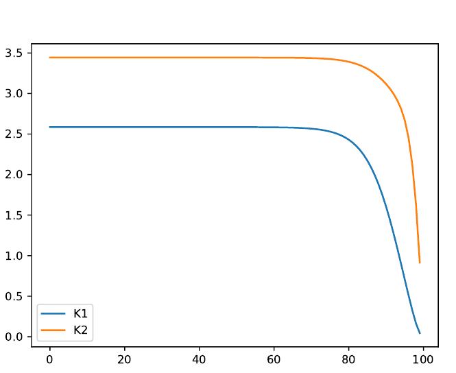\
**The gains $K_k$ of the Riccati recursion are constant far from the end of the horizon (the recursion runs from right to left). That constant value is the infinite-horizon LQR gain.**

The infinite-horizon LQR uses that constant gain. We find it by doing the recursion "long enough until they converge": at the limit $P_k=P_{k+1}=P$ and $K_k=K$, the fixed point of the recursion, which is the **discrete algebraic Riccati equation (DARE)**:

$$
\boxed{\;P=Q+A^TP\big(A-BK\big),\qquad K=\big(R+B^TPB\big)^{-1}B^TPA\;},
\qquad
\boxed{u_k=-K\mathbf x_k=-\big(K_\varphi e_k+K_\omega\omega_k\big)}.
$$

Your `myLqrGain()` implements exactly this fixed-point iteration: start from $P=Q$ (that is, $Q_K=Q$), apply the update until $P$ stops changing, then compute $K$. With one input, $S=R+B^TPB$ is a scalar, and substituting $K$ into the update gives the equivalent form used in the sketch,

$$
P\leftarrow Q+A^TPA-\frac{(A^TPB)(A^TPB)^T}{S},\qquad K=\frac{B^TPA}{S},\qquad S=R+B^TPB .
$$

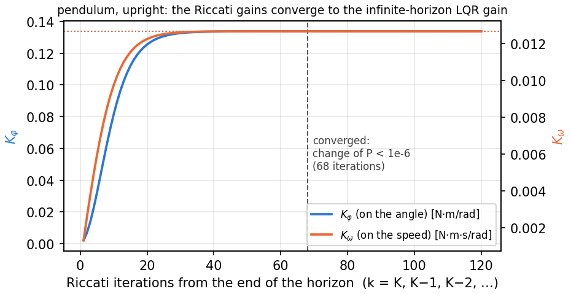\
**The same recursion for the pendulum at the top (for $Q=\mathrm{diag}(10,0.1)$, `LQR_R_SCALE` = 1): $K_\varphi$ and $K_\omega$ converge to the DARE gain $K=[0.134,\ 0.0127]$; the convergence test of the sketch stops after 68 iterations.**

**When does the solution exist?** We choose $Q$ and $R$, not $A$ and $B$. The condition to check is controllability: the controllability matrix $\mathcal C=\begin{bmatrix}B&AB&\cdots&A^{N-1}B\end{bmatrix}$ must have rank $N$. For the pendulum $\mathcal C=[B\ \ AB]$ is $2\times2$ and has rank 2 (the torque accelerates the pendulum, and the speed moves the angle), at both equilibria.

### 1.5 Closed-loop poles and stability

With $u_k=-K\mathbf x_k$ the closed loop is

$$
\mathbf x_{k+1}=(A-BK)\,\mathbf x_k ,
$$

and it is **stable when both eigenvalues $z$ of $A-BK$ are inside the unit circle**, $|z|<1$ (the discrete-time version of $\mathrm{Re}\,s<0$; $z=e^{sT_s}$, $s=\ln z/T_s$). For a $2\times2$ matrix $M=A-BK$ the eigenvalues solve $z^2-\mathrm{tr}(M)\,z+\det(M)=0$; this is the check your `updateLqr()` prints at start-up.

For a controllable system with $Q\succeq0$ (that penalizes the unstable mode) and $R\succ0$, **the infinite-horizon LQR gain is always stabilizing**, whatever weights you choose. An arbitrary gain is not:

  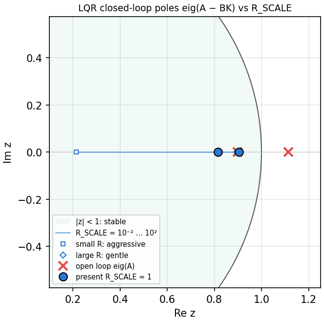
  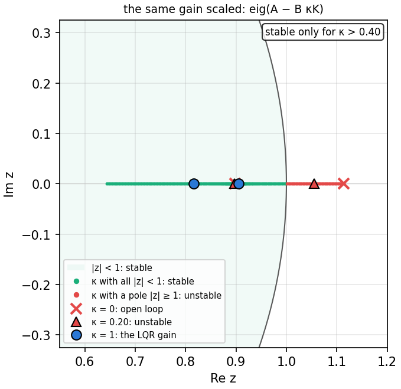

**Example open loop and closed loop eigenvalues for the naturally unstable upright position. Left: the open loop has a pole at $z\approx1.11$ outside the unit circle (×); every LQR gain, for `LQR_R_SCALE` from $10^{-2}$ (aggressive: poles move towards the origin) to $10^{2}$ (gentle: poles stay near the unit circle), puts both poles inside. Right: the same gain scaled, $u=-\kappa K\mathbf x$ — only $\kappa=1$ is the LQR. With $\kappa<0.40$ a pole leaves the unit circle (red): the gain on the angle, $\kappa K_\varphi$, no longer exceeds the gravity torque $G$ (the condition $k_p>G$ of Lab 2).**

At the hanging equilibrium the open loop is already stable (a lightly damped complex pair close to the unit circle); the LQR moves the pair inside, adding damping.

### 1.6 What the weights do

Only the ratios between $q_\varphi$, $q_\omega$ and $R$ matter. A larger $q_\varphi$ makes the angle error more expensive: larger $K_\varphi$, faster return, more torque. A larger $R$ makes the torque more expensive: smaller gains, slower and gentler. $q_\omega$ penalizes the speed and adds damping.

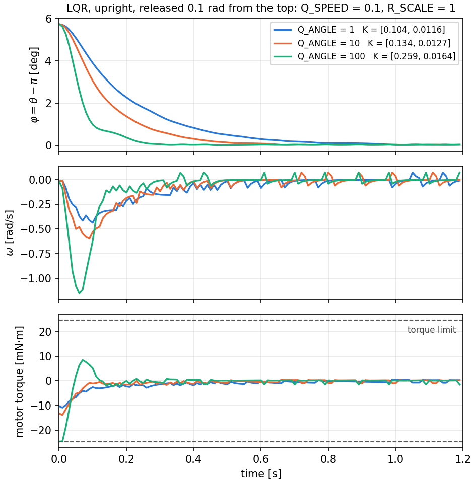\
**Released at rest 0.1 rad from the top, LQR only (example simulation): `LQR_Q_ANGLE` = 1, 10, 100 with `LQR_Q_SPEED` = 0.1, `LQR_R_SCALE` = 1. A larger angle weight returns the angle faster, with a larger speed and a larger torque, here already up to the torque limit.**

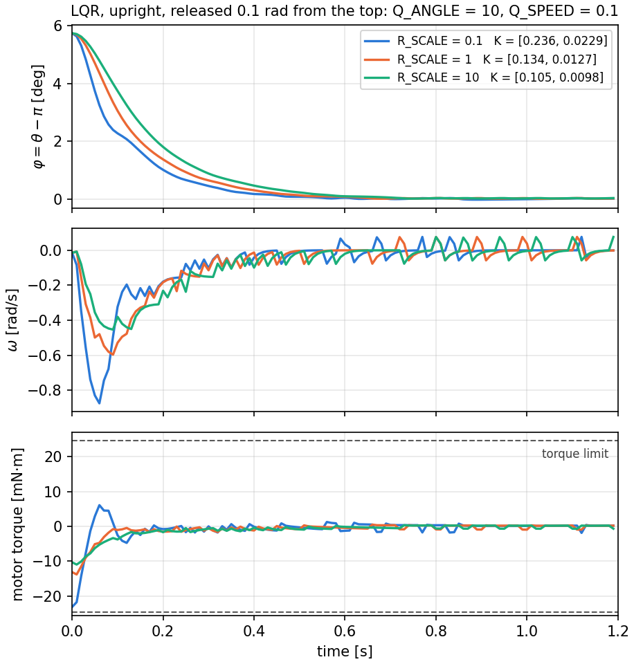\
**The same release for `LQR_R_SCALE` = 0.1, 1, 10 (`LQR_Q_ANGLE` = 10): a cheaper torque (small $R$) gives larger gains and a fast, torque-hungry return; an expensive torque (large $R$) gives a slower, gentler one. The small steps in $\omega$ are the 1.5 mrad resolution of the sensor.**

The LQR design does not know the torque limit: if the gains are large, the command is clipped at $\pm\tau_{\max}$ and the closed loop is no longer the linear one of 1.5. Starting farther from the top makes the clipping last longer; beyond $\varphi_c=\arcsin(\tau_{\max}/G)$ (Lab 2) no gain can bring the pendulum back.

### 1.7 Why LQR does not swing up by itself

The LQR is designed on the linearization at one equilibrium. Far from it, $\sin\theta$ is not linear, and when $\tau_{\max}<G$ the clipped command cannot even hold the pendulum horizontal. A constant-gain feedback has no plan for pumping energy into the swing: started at the bottom with the upright reference, it saturates and the pendulum just tilts.

 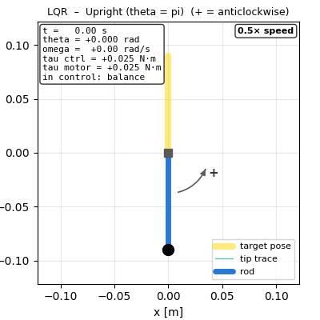\
**Upright LQR alone, started at the bottom (example simulation, $\tau_{\max}=0.46\,G$): the torque saturates, the pendulum swings once and settles tilted near $\arcsin(\tau_{\max}/G)\approx0.48$ rad; it never reaches the top (left: real time; right: 0.5× slow motion).**

The upright LQR therefore needs the pendulum to arrive near the top, inside the capture region of `rig.updateMode()`. The sketch offers the two ways of Lab 2, selected by `USE_SWING_UP` (key `u`): your hand (`USE_SWING_UP 0`), or the energy swing-up of Lab 2 (`USE_SWING_UP 1`, given in the sketch as the `SwingUp` helper).

### 1.8 Summary: From the pendulum model to LQR control

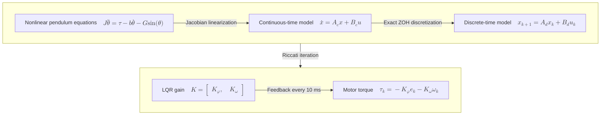

## 2. The library and the sketch

### 2.1 Lab 3 TODOs of your `Pendulum_lar` library (Task 3.1)

The Lab 2 library deliberately left the linearization and discretization functions for this lab. Edit **the same library copy you completed in Lab 2** (normally `libraries/Pendulum_lar/PendulumModel.cpp` in your Arduino folder): it already contains these TODOs, marked `Lab 3`. A fresh copy of the course libraries is in `libs/` of this folder (it contains the Lab 2 TODOs too: if you start from it, complete them first).

| File | Function | What it must do | Used for |
|---|---|---|---|
| `PendulumModel.cpp` | `linearizeUpright(A, B)` | fill $A_c$, $B_c$ at $\theta=\pi$, state $[\varphi,\omega]$ | upright LQR |
| `PendulumModel.cpp` | `linearizeAt(theta, A, B)` | fill $A_c$, $B_c$ at any angle; check $\theta=0$ and $\theta=\pi$ | both equilibria |
| `PendulumModel.cpp` | `discretizeAt(theta, Ts, Ad, Bd)` | the zero-order-hold series of 1.2, with `pendulum_mat_mul()` | `updateLqr()` |
| `PendulumModel.cpp` | `discretizeUpright(Ts, Ad, Bd)` | `discretizeAt(PENDULUM_LAR_PI, …)` | `updateLqr()` |
| `PendulumModel.cpp` | `acceleration(theta, omega, torque)` | solve the nonlinear model of 1.1 for $\ddot\theta$ | nonlinear model checks (NOT REALLY NEEDED HERE) |
| `PendulumModel.cpp` | `step(theta, omega, torque, dt)` | one classical Runge–Kutta 4 step, torque held | nonlinear model checks (NOT REALLY NEEDED HERE) |

The step-by-step instructions are in the TODO comments. Checks: `linearizeAt(π)` must equal `linearizeUpright()`; `A[1][0]` is $-G/J$ at $\theta=0$ and $+G/J$ at $\theta=\pi$; `discretizeUpright()` must equal `discretizeAt(PENDULUM_LAR_PI, …)`.

### 2.2 The sketch `pendulum_lqr_control`

Open `sketches/pendulum_lqr_control/pendulum_lqr_control.ino`.

- **Given:** the settings (`#define`s), the energy swing-up helper `SwingUp` (the Lab 2 law), the prints, the serial keys (`printHelp()`, `handleCommands()`, `printState()`) and the CSV logging. In the `#define`s enter your rig-card values and the two `STORED_...` alignment lines.
- **Yours** (marked `TODO`, with step-by-step instructions in the comments):

| Task | Where | What it must do |
|---|---|---|
| 3.2 | `myLqrGain(Ad, Bd, q_angle, q_speed, r, K)` | iterate the Riccati update of 1.4 from $P=Q$ until $P$ stops changing; then compute $K$; return the iteration count (0 if it does not converge) |
| 3.2a | the global declarations | the objects `foc` (`FOC_lar`) and `rig` (`Pendulum_lar`), the helper `swing` (`SwingUp`), and the variables `max_torque`, `K[2]`, `equilibrium`, `lqr_iterations` (the sketch compiles only once they exist) |
| 3.2b | `updateLqr()` | the discrete model of the selected equilibrium (`rig.discretizeUpright()` / `rig.discretizeAt(0, …)`), the call of `myLqrGain()`, and the closed-loop eigenvalue check of 1.5 (the prints are given) |
| 3.2c | `setup()` | start the motor (stored alignment, calibration), the pendulum rig and its model, `max_torque`, the Coulomb compensation and capture angles, the swing-up helper, and the LQR (`updateLqr()`, stop if it fails) |
| 3.2d | `loop()` | the control loop: `foc.update()`, `rig.update()`, the reset at the start, the wrapped error $e$, the swing-up / hand-lift branch, and the LQR law $u=-(K_\varphi e+K_\omega\omega)$ clipped to $\pm\tau_{\max}$ |

**Serial commands.** `s` starts a run (the pendulum must hang at rest: that is $\theta=0$) and `x` stops it (0 V). `1` / `2` select the hanging / upright equilibrium and recompute $K$ (`EQUILIBRIUM` only sets the value at power-up). `u` switches the swing-up helper on and off (`USE_SWING_UP` sets it at power-up). `p` pauses the CSV log, `h` prints the list.

**Logging (optional).** Close the Serial Monitor and capture a run with `python tools/plot_log.py --port /dev/ttyUSB0 --out run.csv` (on Windows use your port, e.g. `COM3`); the script sends `s`, saves the CSV and plots it. The `mode` column is 1 while the LQR is in control.

## 3. Implement and test

### 3.1 Tasks 3.1 – 3.2d

1. **Task 3.1:** the library TODOs of 3.1. Compile any sketch that includes `Pendulum_lar.h` to check them.
2. **Task 3.2:** `myLqrGain()`. In each iteration, with $Q=\mathrm{diag}(q_\varphi,q_\omega)$:
   1. $T=PB$ (2-vector), $S=R+B^TT$ (scalar), $L=A^TT=A^TPB$ (2-vector);
   2. $P_{\mathrm{new}}=Q+A^TPA-LL^T/S$;
   3. the largest element-wise change $\max|P_{\mathrm{new}}-P|$; then $P\leftarrow P_{\mathrm{new}}$;
   4. when that change is below $10^{-6}\max(P_{00},1)$: recompute $T$ and $S$ with the final $P$, set $K=T^TA/S$ ($=B^TPA/S$) and return the iteration count.

   This is the infinite-horizon gain of 1.4, not the continuous-time pole placement of Lab 2: it must use `Ad`, `Bd` and the sample period.
3. **Tasks 3.2a – 3.2d:** follow the numbered steps in the TODO comments. Start with `USE_SWING_UP 0` and `EQUILIBRIUM 1`.

At power-up the sketch prints $G$, $\tau_{\max}$, `Ad`, `Bd`, your `K`, the number of iterations and the largest closed-loop $|z|$. Do not continue if it reports *UNSTABLE*.

### 3.2 Run A — hanging equilibrium and sign check

1. Select `1` (hanging). Use `MOTOR_VOLTAGE_LIMIT = 1.0` V for the first run.
2. With the pendulum hanging at rest send `s`, move the arm a little by hand and check that the motor pushes it **back** to $\theta=0$. If it pushes away, stop with `x` and check the sensor direction and the sign of your error. Do not continue until the sign is correct.
3. Restore the approved voltage limit, run for about 20 s, give the mass one firm push and let it settle.

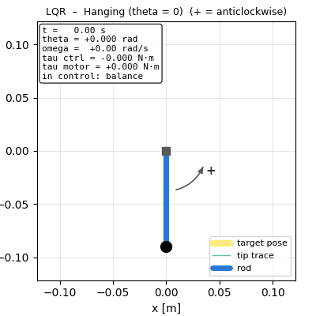 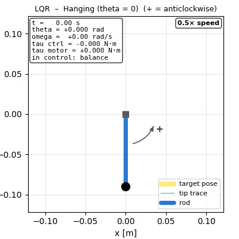\
**A strong push (−6 rad/s at 0.5 s) at the hanging equilibrium; the LQR brings the pendulum back in about 0.3 s (example simulation, left: real time; right: 0.5× slow motion).**

***Optional:** record the peak angle after the push, the recovery time, the final resting angle and the peak torque, and save the log as `lqr_hanging.csv`.*

### 3.3 Run B — upright, LQR only (lift by hand)

Select `2` with `USE_SWING_UP 0` (or press `u` until the sketch prints *LQR only: lift the pendulum by hand*). Start a run with the pendulum hanging: the motor stays at zero torque. Lift the pendulum slowly by hand towards the top; within `CAPTURE_ANGLE` of the top `rig.updateMode()` switches to `BALANCE` and you feel the LQR pull it up. Bring it closer than $\varphi_c$ and let go gently.

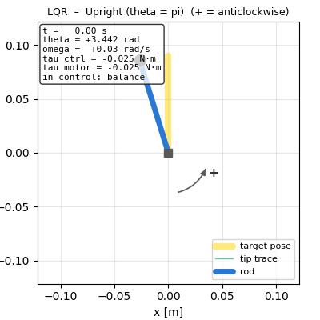 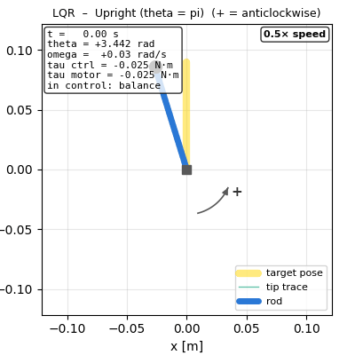\
**Released at rest 0.3 rad from the top, the upright LQR brings the pendulum to the top and holds it (example simulation, left: real time; right: 0.5× slow motion).**

Repeat with `LQR_Q_ANGLE = 100`, then with `LQR_R_SCALE = 10` (the other weights unchanged), and compare with the figures of 1.6: speed of the return, peak torque, time at the torque limit, and the noise in the torque. Check the printed $K$ and $\max|z|$ each time.

***Optional:** save the logs as `lqr_upright.csv`, `lqr_upright_q100.csv`, `lqr_upright_r10.csv`, and record the RMS of $\varphi$ during the last 10 s.*

### 3.4 Run C — upright with the swing-up

Press `u` (or set `USE_SWING_UP 1`), select `2`, and start with the pendulum hanging at rest, under the instructor's supervision. The given energy swing-up pumps the pendulum up; the LQR takes over when `rig.updateMode()` reports `BALANCE`. Run for about 20 s.

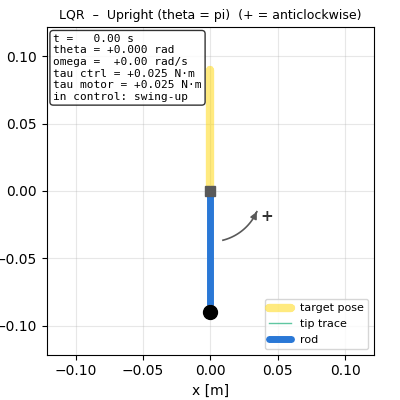 \
**Energy swing-up + LQR: two pumping swings, capture near the top after about 1.3 s, balance (example simulation, 3 V maximum voltage; left: real time; right: 0.5× slow motion).**

Record whether and when the pendulum was captured, whether it stayed up, the peak torque and any fall. If it captures and then falls, look at the speed and the saturation at the capture.

## Further reading

- K. Chatzilygeroudis, *Applied Optimal Control*, Lecture 4: Deterministic Optimal Control & LQR (`LQR_slides_notes.pdf`).
- K. J. Åström and R. M. Murray, *Feedback Systems: An Introduction for Scientists and Engineers*, Princeton University Press, 2008 — <https://fbsbook.org/>.
- B. D. O. Anderson and J. B. Moore, *Optimal Control: Linear Quadratic Methods*, Prentice Hall, 1990.
